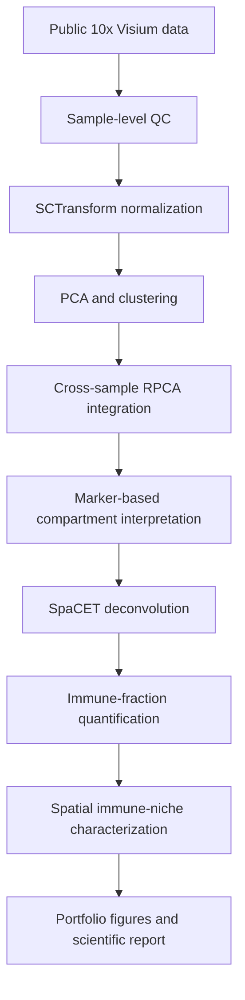

# Spatial organization of malignant and immune compartments in HNSCC

An independent spatial transcriptomics portfolio project using public 10x Genomics Visium data to describe malignant and immune organization across two HNSCC tissue sections.

This repository is designed as a transparent, end-to-end analysis record for bioinformatics engineers, computational biologists and technical recruiters. It connects documented R notebooks, saved analysis objects, reusable result tables, publication-style figures, 

- [Read the full scientific report](https://fadwa7.github.io/spatial-hnscc-immune-niches/reports/HNSCC_spatial_transcriptomics_report.html)

## Background

Head and neck squamous cell carcinoma (HNSCC) contains malignant epithelial, stromal, vascular and immune compartments arranged within a heterogeneous tissue microenvironment. Standard 10x Genomics Visium assays retain spatial coordinates while measuring expression in spots that may contain multiple cells. Spot-level profiles therefore represent local transcriptional mixtures rather than single-cell measurements.

This project uses spatial expression patterns, transcriptome-based clustering and deconvolution to describe tissue organization. It does not infer direct cell-cell interaction, clinical response or causal biological mechanisms.

## Reference Study and Project Positioning

This independent portfolio project was inspired by the study:

> Adimi Y. et al. *A new spatial multi-omics approach to deeply
> characterize human cancer tissue using a single tissue section*.
> bioRxiv, 2024.  
> DOI: [10.1101/2024.10.03.616510](https://doi.org/10.1101/2024.10.03.616510)

The original study, conducted by researchers affiliated with Sanofi R&D
and academic clinical institutions, combined 10x Visium spatial
transcriptomics with Phenocycler spatial proteomics on head and neck
squamous cell carcinoma tissue sections.

This portfolio does not reproduce the complete multi-omics study.
It focuses exclusively on the publicly available ST-only Visium data
and develops an independent transcriptomics workflow covering:

- sample-level quality control and clustering;
- cross-sample RPCA integration;
- marker-based interpretation of spatial transcriptional domains;
- SpaCET deconvolution of malignant, stromal and immune compartments;
- sample-relative spatial immune-niche characterization.

The original manuscript, public dataset and companion repository were
used as scientific and methodological references. All interpretations
presented here were derived independently from the analyses documented
in this repository.

### Original resources

- [Preprint](https://doi.org/10.1101/2024.10.03.616510)
- [Public dataset on Zenodo](https://zenodo.org/records/13736222)
- [Companion analysis repository](https://github.com/EPL-repo/PP_ST_multi)


## Biological question

> **How are malignant and immune compartments spatially organized across two HNSCC tissue sections?**

The analysis focuses on spatial transcriptional domains, estimated malignant and immune contributions, and sample-relative immune niches. Distinct malignant transcriptional states were not formally characterized.

## Dataset

The project analyzes two biological HNSCC tissue sections from a public 10x Genomics Visium dataset. Each sample is processed independently before descriptive cross-sample integration and comparison.

| Sample | Platform | Input | Working clustering resolution | Analytical role |
|:--|:--|:--|:--:|:--|
| 17B5776 | 10x Genomics Visium | Filtered Space Ranger expression matrix, tissue image and spatial coordinates | 0.6 | Sample-level analysis, integration and SpaCET deconvolution |
| 19H1257 | 10x Genomics Visium | Filtered Space Ranger expression matrix, tissue image and spatial coordinates | 0.8 | Sample-level analysis, integration and SpaCET deconvolution |

The repository does not currently document a dataset accession or primary publication. Raw data are excluded from version control and are expected under the paths recorded in [`config/samples.tsv`](config/samples.tsv).

## Analysis overview

The analysis follows the existing notebook order:

1. Import filtered Space Ranger counts, tissue images and spatial coordinates.
2. Evaluate transcript, detected-feature and mitochondrial quality metrics in distributional and tissue space.
3. Apply the documented filters, normalize each sample with SCTransform, and construct PCA, neighbor-graph and UMAP representations.
4. Evaluate sample-level clustering resolutions and interpret spatial domains using marker genes and tissue localization.
5. Merge both samples and perform reciprocal PCA (RPCA) integration for descriptive joint clustering.
6. Apply SpaCET independently with the HNSC cancer model to estimate malignant, stromal and immune transcriptional fractions.
7. Derive a total immune fraction from major immune lineages and define Immune-low, Intermediate and Immune-high spots using quartiles calculated separately within each sample.
8. Summarize the relative immune-lineage composition of Immune-high niches and assemble portfolio figures, tables and reporting outputs.

Major and subordinate SpaCET hierarchy levels are not summed because they overlap. SpaCET outputs are estimated transcriptional fractions, not exact cell counts.

## Workflow diagram



## Repository structure

The tree below reflects the current project layout while omitting generated support libraries and individual binary objects for readability.

```text
.
├── README.md
├── AGENTS.md
├── LICENSE
├── _quarto.yml
├── index.qmd
├── methods.qmd
├── results.qmd
├── styles.scss
├── config/
│   ├── config.yaml                  # currently empty
│   └── samples.tsv                  # sample identifiers and local data paths
├── data/                            # local raw/external data; not versioned
├── notebooks/
│   ├── 01_exploration_17B5776.Rmd
│   ├── 02_exploration_19H1257.Rmd
│   ├── 03_cross_sample_comparison.Rmd
│   └── 04_spacet_deconvolution.Rmd
├── reports/
│   └── HNSCC_spatial_transcriptomics_report.Rmd
├── results/
│   ├── figures/                     # exported PNG figures
│   ├── objects/                     # local RDS analysis objects; not versioned
│   └── tables/                      # marker and SpaCET summary tables
├── workflow/
│   ├── Snakefile
│   ├── rules/
│   └── scripts/                     # empty workflow scaffold; not executable
├── _freeze/                         # cached Quarto execution results
├── _site/                           # rendered local portfolio
├── renv.lock
└── spatial-hnscc-immune-niches.Rproj
```

An additional legacy file, `notebooks/01_exploration.Rmd`, is present but is not part of the four-notebook analysis sequence documented in the scientific report.

## Notebook overview

| Notebook | Main tools | Purpose | Main outputs |
|:--|:--|:--|:--|
| [`01_exploration_17B5776.Rmd`](notebooks/01_exploration_17B5776.Rmd) | Seurat, SCTransform, ggplot2, clustree, hdf5r, here | Import and quality-control sample 17B5776; perform PCA, UMAP, clustering and marker-guided domain assessment | Clustered Seurat object at resolution 0.6, marker table and exploratory/spatial figures |
| [`02_exploration_19H1257.Rmd`](notebooks/02_exploration_19H1257.Rmd) | Seurat, SCTransform, ggplot2, clustree, hdf5r, here | Import and quality-control sample 19H1257; perform PCA, UMAP, clustering and marker assessment | Clustered Seurat object at resolution 0.8 and notebook-embedded exploratory results |
| [`03_cross_sample_comparison.Rmd`](notebooks/03_cross_sample_comparison.Rmd) | Seurat, RPCA integration, dplyr, ggplot2, patchwork, here | Harmonize metadata, merge both samples, create joint and integrated representations, identify markers and project integrated clusters into tissue space | Integrated resolution-0.6 Seurat object, integrated UMAP, spatial cluster maps and marker tables |
| [`04_spacet_deconvolution.Rmd`](notebooks/04_spacet_deconvolution.Rmd) | SpaCET, dplyr, tidyr, tibble, ggplot2, here | Estimate cellular transcriptional fractions, derive total immune fractions, classify sample-relative immune niches and summarize Immune-high composition | SpaCET objects, combined spot-level fractions, summary tables and immune-niche figures |

## Main results

The following are verified descriptive observations from the notebooks and saved results:

- Both sections contain spatially structured transcriptional heterogeneity at the Visium-spot level.
- Marker-guided analysis of 17B5776 identifies domains associated with immune, epithelial, stromal, hypoxic, inflammatory, interferon-responsive and proliferative programs. These are provisional mixed-spot annotations, not purified cell types.
- Most integrated clusters contain spots from both samples, while some are sample-enriched; integrated labels also form structured tissue domains.
- The saved SpaCET summaries show a higher median estimated malignant fraction in 19H1257 and a higher median derived immune fraction in 17B5776. These are section-level descriptions, not population-level effects.
- The median derived immune fractions are 0.318 for 17B5776 and 0.100 for 19H1257 after rounding to three decimal places.
- Immune-high niches contain mixed lineage-associated transcriptional signals. Neutrophils have the largest mean relative share in the saved Immune-high composition summaries for both samples.

Representative outputs are available in [`results/figures`](results/figures) and numerical summaries in [`results/tables`](results/tables).

## Reproducibility

- The four notebooks preserve the sequential computational record from sample-level preprocessing to niche characterization.
- Project-relative paths are handled with the `here` package.
- Fixed random seeds are specified for UMAP and clustering where documented.
- Intermediate RDS objects, marker tables, spot-level fractions and summary tables separate expensive computation from reporting.
- The Quarto site uses frozen execution results and embeds existing PNG, CSV and TSV outputs.
- [`renv.lock`](renv.lock) records R 4.3.3 and the current reporting environment.

The current `renv.lock` does not include the full analysis stack, notably Seurat and SpaCET. Exact package versions used for the completed analysis therefore require manual verification before full computational reproduction.

## Installation and usage

### Requirements

- R 4.3.3, as recorded in `renv.lock`
- Quarto for the portfolio website
- R packages used in the notebooks, including Seurat, SpaCET, `ggplot2`, `dplyr`, `tidyr`, `tibble`, `patchwork`, `clustree`, `hdf5r` and `here`
- Filtered Space Ranger outputs for both samples at the paths specified in `config/samples.tsv`

Restore the packages currently captured by `renv.lock`:

```r
install.packages("renv")
renv::restore()
```

Because the lockfile does not yet capture all analysis dependencies, verify and install the missing analysis packages separately before running the notebooks.

To inspect the existing portfolio without rerunning the analysis, open `_site/index.html` in a browser or start a local Quarto preview:

```bash
quarto preview
```

To render the scientific report from saved tables and figures:

```bash
Rscript -e "rmarkdown::render('reports/HNSCC_spatial_transcriptomics_report.Rmd')"
quarto render
```

Run the four notebooks in numerical order only when the raw data and analysis dependencies are available. SCTransform, marker detection, integration and SpaCET deconvolution are computationally more expensive than rendering the portfolio.

The files under `workflow/` are currently empty placeholders and cannot be used to run the analysis with Snakemake.

## Project status

The exploratory analysis, two-sample RPCA integration, SpaCET deconvolution, immune-niche summaries, saved result tables, portfolio figures, Quarto site and scientific report are present. The project should be considered a documented portfolio analysis rather than a production pipeline or a population-level HNSCC study.

Before public release, the data accession, source citation, public repository URL, GitHub Pages URL and complete analysis software environment still need to be documented and verified. The reported retained-spot count for 19H1257 also requires manual confirmation because the notebook refers to an apparently undefined `dim_after_qc` object.

## Limitations

- Only two biological samples are included; all cross-sample comparisons are descriptive.
- Spots within a tissue section are spatially correlated and are not independent biological replicates.
- A standard Visium spot may contain multiple cells, so clusters and niches represent mixed local transcriptional signals.
- Quality-control thresholds may remove genuine low-complexity tissue as well as technical failures.
- Cluster interpretation is marker-guided and provisional; a single marker does not establish cell identity.
- RPCA integration may retain technical structure or attenuate genuine sample-specific biology.
- SpaCET fractions depend on reference signatures and model assumptions and do not represent exact cell counts.
- Immune-high and Immune-low categories use sample-specific quartiles, so labels are relative within each section and are not directly equivalent across samples.
- Relative Immune-high composition is compositional and does not measure absolute abundance or enrichment against Immune-low spots.
- Distinct malignant transcriptional states were not formally characterized.
- No clinical, therapeutic or population-level conclusions can be drawn from this study design.

## Future directions

Future work should remain separate from the completed analysis and could include:

- adding more biological samples to support replicated, population-level spatial inference;
- formally characterizing malignant transcriptional states with an explicitly validated analysis strategy;
- validating spatial domains and immune niches against tissue histology or independent biological measurements;
- evaluating spatial autocorrelation and replicated spatial statistics where the expanded study design supports them;
- completing and testing the workflow scaffold, capturing the full analysis environment and adding automated reproducibility checks;
- documenting the public dataset accession, primary citation and a permanent public portfolio URL.

## Author

**Fadwa EL KHADDAR**

Independent bioinformatics portfolio project based on public data.
