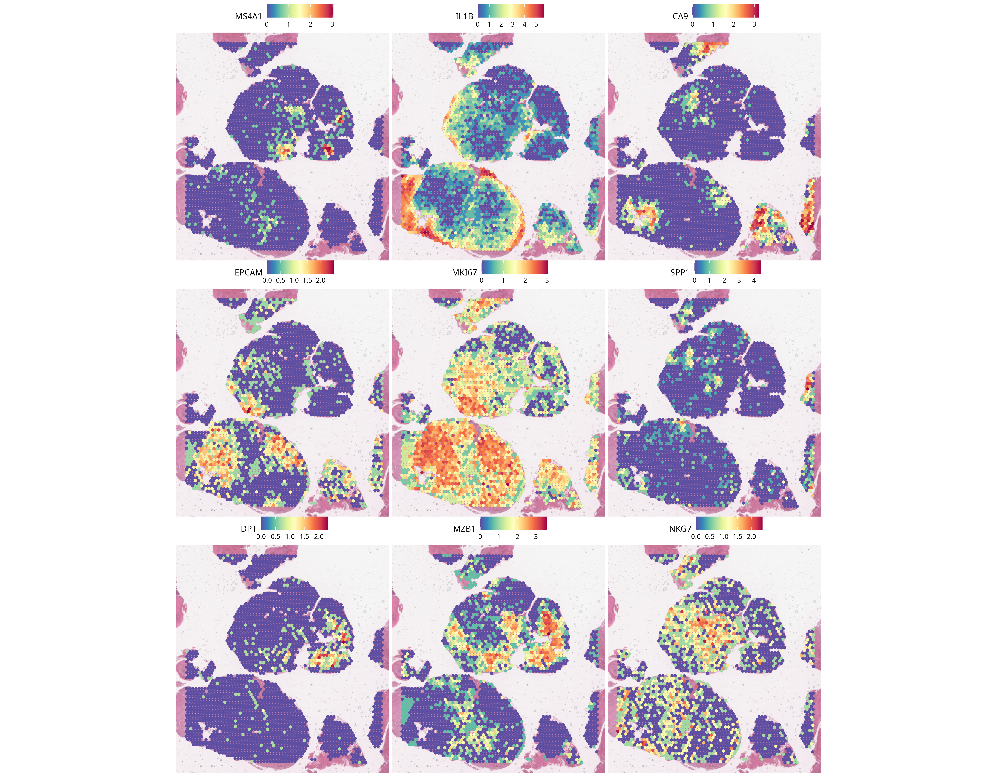
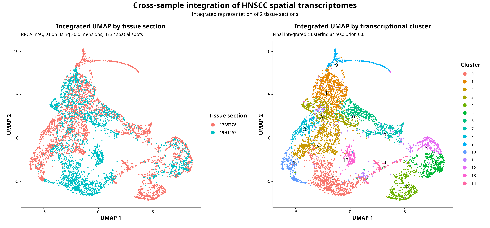
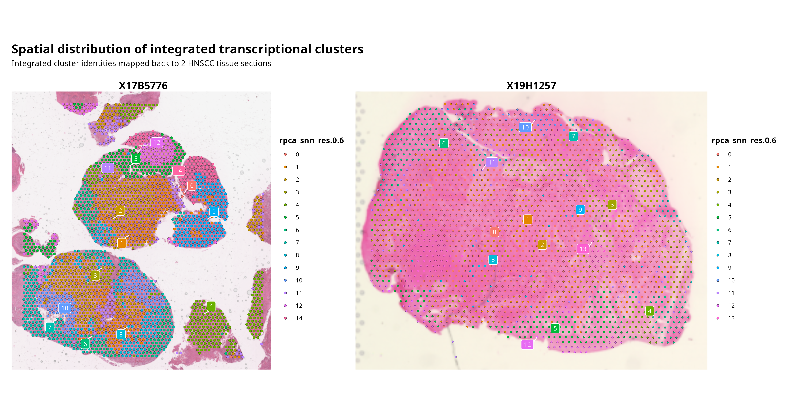
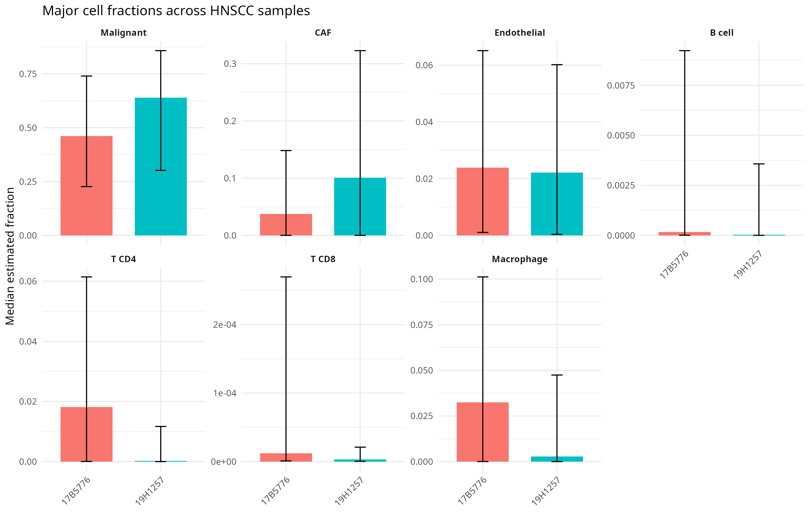
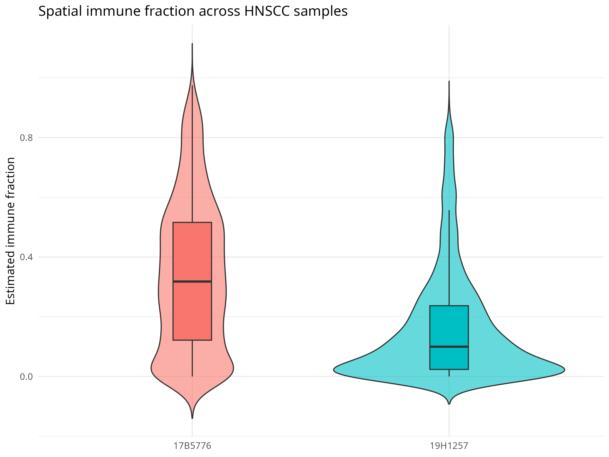
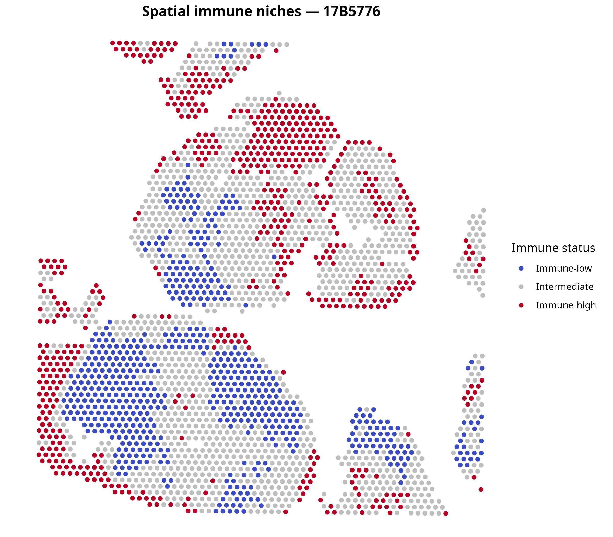
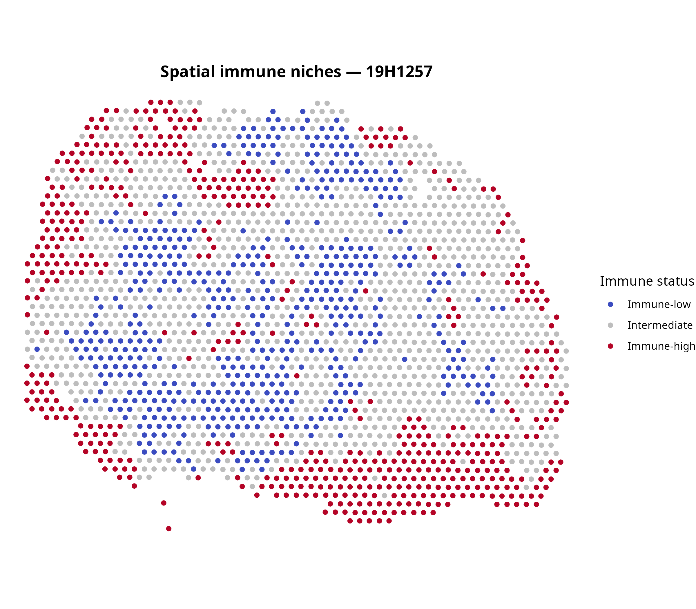
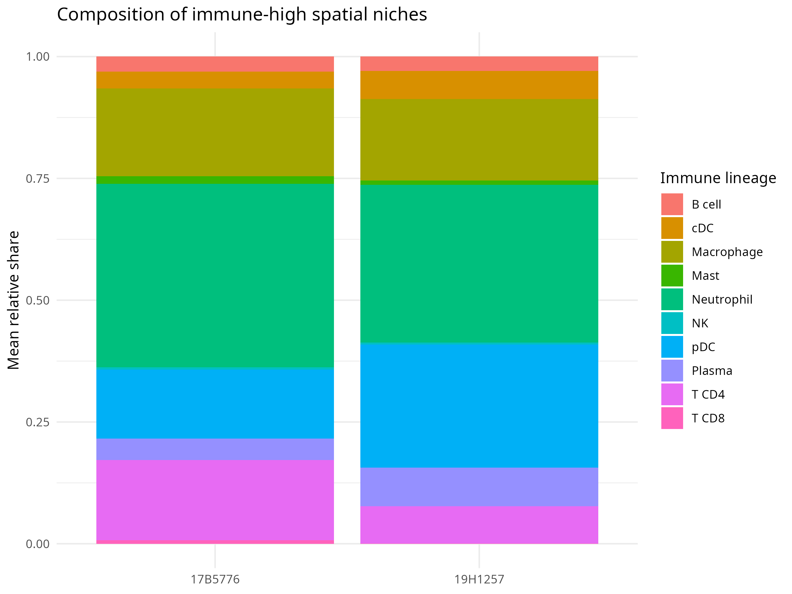

::: {.callout-important appearance="simple" icon=false}
This results page describes **two biological samples**. Cross-sample comparisons are descriptive, not inferential. A Visium spot may contain multiple cells, and SpaCET outputs are estimated transcriptional fractions rather than exact cell counts.
:::

## Sample-level quality control

::: {.panel-tabset}
### 17B5776

The notebook reports 2,582 initial spots and 2,517 retained spots after applying the existing criteria of more than 200 detected genes and less than 10% mitochondrial transcripts. Most excluded spots were documented in a restricted lower-tissue region associated with elevated mitochondrial signal. Genes detected in fewer than three retained spots were subsequently removed.

**Observation.** Quality metrics and excluded spots were spatially structured rather than uniformly distributed.

**Interpretation.** Local low-complexity or high-mitochondrial signal may reflect technical degradation, local tissue condition or both; the QC metrics do not establish the cause.

### 19H1257

The notebook reports 2,216 initial spots. It states that one spot met the low-feature exclusion criterion and that none exceeded the 10% mitochondrial threshold. Low-feature candidates were mainly located near tissue boundaries.

**Observation.** The selected thresholds had a minimal effect on retained spots in this section.

**Verification note.** The notebook's inline QC text refers to an apparently undefined `dim_after_qc` object. The stated retained-spot count should be confirmed before publication.
:::

::: {.callout-note appearance="simple"}
No standalone QC figures are currently saved in `results/figures/`. The QC maps remain embedded in the sample notebooks and are not recreated here.
:::

## Spatial clustering

::: {.panel-tabset}
### 17B5776

Resolution 0.6 was selected as the working clustering solution. Marker-guided assessment described mixed spatial domains associated with immune, epithelial, stromal, hypoxic, inflammatory, interferon-responsive and proliferative programs.

{.lightbox fig-alt="Tissue-coordinate maps showing the spatial expression of nine selected marker genes in sample 17B5776."}

**Observation.** Several marker programs form localized patterns in the tissue section.

**Interpretation.** Spatial localization complements the transcriptomic clustering because coordinates were not used to construct the expression graph. It does not establish pure cell identity or direct cellular interaction.

### 19H1257

Resolution 0.8 was selected after comparison with resolution 0.6. The notebook reports that the finer solution primarily subdivided two clusters and that the resulting groups showed distinct marker profiles.

::: {.callout-note appearance="simple"}
No standalone 19H1257 clustering or marker figure is available in `results/figures/`; no substitute image is generated.
:::
:::

## RPCA integration

The sample-specific objects were merged, represented with a joint PCA and integrated with reciprocal PCA. Integrated resolution-0.6 clusters were used for marker assessment and spatial projection.

**Observation.** The cross-sample notebook reports that most integrated clusters contained spots from both samples, while several clusters were enriched in one section. Integrated labels also formed structured domains in tissue space.

**Interpretation.** Shared clusters are consistent with recurrent transcriptional programs. Sample-enriched clusters may reflect biological heterogeneity, sampled tissue composition, technical variation or incomplete integration.

::: {.panel-tabset}

## Integrated UMAP

{fig-alt="Integrated RPCA UMAP showing HNSCC spatial spots colored by tissue section and integrated transcriptional cluster." lightbox=true}

## Spatial clusters

{fig-alt="Spatial maps showing integrated transcriptional clusters across the two HNSCC tissue sections." lightbox=true}

:::

::: {.callout-note}
RPCA integration can retain technical differences or attenuate genuine
sample-specific biology. Visual mixing in the integrated UMAP is not
sufficient evidence of complete batch-effect removal.
:::

[Download all integrated-cluster markers](results/tables/integrated_cluster_markers_res0.6.tsv){.btn .btn-outline-primary}
[Download the top-five marker table](results/tables/integrated_cluster_top5_markers_res0.6.tsv){.btn .btn-outline-secondary}

## SpaCET deconvolution

SpaCET was run independently for each section with the HNSC cancer model. Major malignant, stromal and immune lineage estimates were extracted into a combined spot-level table. Major and subordinate hierarchy levels were not added together because they overlap and would be double-counted.

::: {.workflow-step}
**1. Spatial counts**

Raw Visium gene-expression counts were processed independently for each
tissue section.
:::

::: {.workflow-arrow}
→
:::

::: {.workflow-step}
**2. SpaCET deconvolution**

The HNSC cancer model was used to estimate malignant, stromal and immune
transcriptional contributions for every spatial spot.
:::

::: {.workflow-arrow}
→
:::

::: {.workflow-step}
**3. Spatial niches**

Estimated fractions were summarized and mapped to identify immune-rich
and immune-low tissue regions.
:::

::: {.callout-important appearance="simple"}
SpaCET fractions are **estimated transcriptional contributions**, not exact cell counts. A larger fraction does not directly imply a corresponding number of cells.
:::

[Download spot-level SpaCET fractions](results/tables/spacet_spot_cell_fractions.csv){.btn .btn-outline-primary}

## Major cell fraction comparison

{.lightbox fig-alt="Faceted bar chart comparing median malignant, CAF, endothelial, B-cell, CD4 T-cell, CD8 T-cell and macrophage fraction estimates across the two samples."}

**Observation.** The saved summary shows a higher median estimated malignant fraction and a higher median CAF fraction in 19H1257 than in 17B5776. Median endothelial estimates are similar in magnitude.

**Interpretation.** These differences describe the two tissue sections and may reflect tissue composition, spatial sampling or model behavior. They are not population-level HNSCC effects.

[Download the compartment summary](results/tables/spacet_cell_fraction_summary.csv){.btn .btn-outline-primary}

## Immune-fraction distributions

The derived total immune fraction sums only the major immune lineage estimates: Plasma, B cell, T CD4, T CD8, NK, cDC, pDC, Macrophage, Mast and Neutrophil.

{.lightbox fig-alt="Violin and box plots comparing spot-level derived immune-fraction distributions between the two tissue sections."}

**Observation.** The saved summary reports a median derived immune fraction of 0.318 in 17B5776 and 0.100 in 19H1257 after rounding to three decimals.

**Interpretation.** The distributions show within-section heterogeneity. Spots are spatially related and must not be treated as independent patient measurements.

[Download the immune-fraction summary](results/tables/spacet_immune_fraction_summary.csv){.btn .btn-outline-primary}

## Spatial immune niches

Immune-low, Intermediate and Immune-high categories were defined independently in each sample. Spots at or below the sample-specific first quartile were labelled Immune-low, spots at or above the third quartile were labelled Immune-high, and all remaining spots were labelled Intermediate.

An Immune-high spot in one sample is not necessarily equivalent in absolute immune fraction to an Immune-high spot in the other sample.

::: {.panel-tabset}
### 17B5776

{.lightbox fig-alt="Spatial scatter plot of sample-relative immune niche categories across tissue section 17B5776."}

### 19H1257

{.lightbox fig-alt="Spatial scatter plot of sample-relative immune niche categories across tissue section 19H1257."}
:::

**Observation.** The three relative categories are spatially distributed within each section rather than summarized by one section-wide value.

**Hypothesis.** Local aggregation could reflect heterogeneous immune microenvironments. Testing that hypothesis requires additional samples, histological validation and replicated spatial inference.

## Composition of Immune-high niches

Within each Immune-high spot, every major immune-lineage fraction was divided by the total immune fraction. The resulting shares were averaged separately by sample.

{.lightbox fig-alt="Stacked bar chart showing the mean relative contributions of ten immune lineages to Immune-high spots in each sample."}

**Observation.** Neutrophils have the largest mean relative share in both saved sample summaries. Macrophage, T CD4 and pDC signals also contribute materially in 17B5776; pDC and macrophage signals are the next largest shares in 19H1257.

**Interpretation.** Immune-high niches contain mixed lineage-associated signals. Relative shares do not represent absolute abundance or enrichment compared with Immune-low spots.

[Download the Immune-high composition table](results/tables/spacet_immune_high_niche_composition.csv){.btn .btn-outline-primary}

::: {.callout-note appearance="simple"}
## Malignant-state scope

The current analysis maps estimated malignant fractions and evaluates marker-associated epithelial domains, but it does **not** formally characterize distinct malignant transcriptional states.
:::

